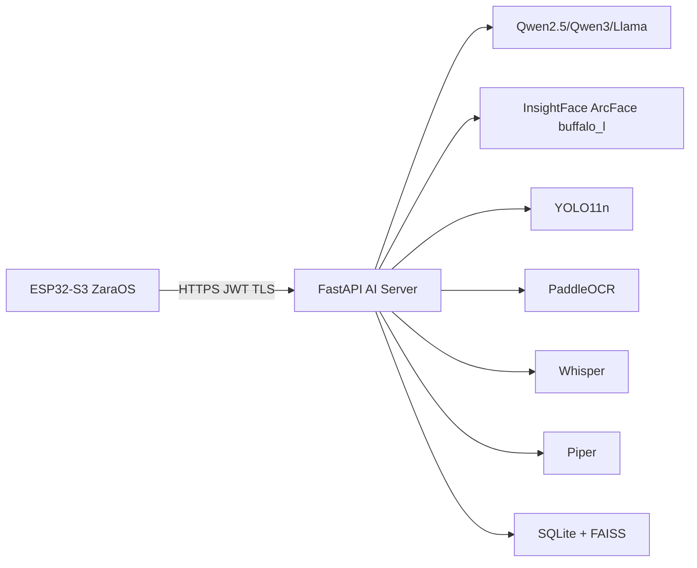

# Zara AI Server Deployment

`ai_server/` contains the runnable backend that pairs with `components/ai_client` in the firmware.

## Fresh machine workflow

1. `cd ai_server && cp .env.example .env`
2. `./setup.sh`
3. `./run.sh`
4. `ZARA_LOCAL_TESTING=true pytest tests`
5. `python zara_simulator.py --base-url http://localhost:8443 "Zara follow me"`

The ESP32 keeps hard real-time responsibilities. The backend performs heavy AI inference and returns JSON commands that match the firmware parser.
